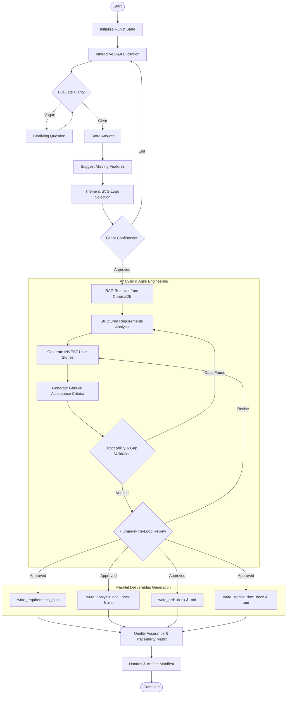

# AI Business Analyst Agent

An AI-powered Business Analyst Agent built with LangChain, LangGraph, and RAG (Retrieval-Augmented Generation) using ChromaDB.

The agent helps turn project ideas into structured software requirements. It gathers information through interactive questions, suggests missing features, analyses requirements using reference documents, and generates user stories with acceptance criteria.

It also checks that requirements are properly connected and covered before generating the final project documents in Word, Markdown, and JSON formats.

---

## Architecture Overview



---

## Key Features

- **Interactive Requirement Gathering:** Collects project details through questions, asks follow-ups when needed, and suggests features that may have been overlooked.
- **LangGraph Workflow:** Manages the different stages of the agent, including conditional steps, review points, and revision loops.
- **RAG with ChromaDB:** Retrieves relevant information from reference documents to support requirements analysis.
- **Flexible Embeddings:** Supports local HuggingFace embeddings and Google Gemini embeddings.
- **Multiple LLM Providers:** Supports Google Gemini and OpenRouter, with configurable models.
- **Knowledge Base Management:** Uses SHA256 hashing and document IDs to avoid processing unchanged documents again.
- **Requirements Traceability:** Connects client features to Functional Requirements (FRs), User Stories (USs), and Acceptance Criteria (ACs).
- **Document Generation:** Exports project documents in Word (.docx) and Markdown (.md), along with structured JSON files.

### Requirements & Analysis Methods

The agent uses the following guidelines:

- **MoSCoW:** Prioritises features as Must Have, Should Have, Could Have, and Won't Have (for now).
- **INVEST:** Guidelines for writing clear and manageable user stories.
- **Gherkin:** A format for writing test scenarios using Given, When, and Then.
- **ISO/IEC 25010:** Software quality standards covering areas such as security, usability, and performance.

---

## Project Structure

```
BusinessAnalyst-Agent/
├── agent/                        # LangGraph workflow orchestration
│   ├── graph.py                  # StateGraph definition and node edge wiring
│   ├── nodes.py                  # Atomic workflow nodes (elicitation, RAG, docs, QA)
│   ├── routing.py                # Conditional routing and input parsing helpers
│   └── state.py                  # TypedDict shared graph state schema
├── config/                       # Configuration and constants
│   ├── constants.py              # Elicitation questions, color presets, logo styles
│   └── settings.py               # Paths, RAG parameters, environment settings
├── knowledge_base/               # Raw markdown/pdf/docx domain guidance files
│   ├── business_analysis_standards.md   # ISO 25010, MoSCoW, INVEST, Gherkin guide
│   └── sample_ecommerce_best_practices.md # E-commerce architecture best practices
├── services/                     # Reusable modular services
│   ├── document_ingestion_service.py # Multi-format document parser & text chunker
│   ├── document_service.py       # Styled Word (.docx) & Markdown (.md) generator
│   ├── embedding_service.py      # Local HuggingFace & Gemini embeddings abstraction
│   ├── llm_service.py            # Gemini & OpenRouter LLM clients with JSON retries
│   ├── retrieval_service.py      # RAG orchestration and similarity query layer
│   └── vector_store_service.py   # ChromaDB wrapper with manifest-based dedup
├── scripts/                      # Operational scripts
│   └── ingest_knowledge_base.py  # Standalone CLI knowledge base ingestion script
├── tests/                        # Comprehensive automated unit test suite
│   ├── test_document_ingestion.py
│   ├── test_document_service.py
│   ├── test_graph.py
│   └── test_routing.py
├── outputs/                      # Isolated run deliverables
│   └── runs/<run_id>/            # Per-run generated deliverables
├── main.py                       # Application CLI entry point
├── requirements.txt              # Production dependency specifications
├── .env.example                  # Environment configuration template
└── README.md                     # Repository documentation
```

---

## Getting Started

### 1. Prerequisites
- **Python 3.10 to 3.13** installed.

### 2. Installation
Clone the repository and set up a virtual environment:

```bash
git clone https://github.com/your-username/BusinessAnalyst-Agent.git
cd BusinessAnalyst-Agent

python -m venv .venv

# On Windows:
.venv\Scripts\activate

# On Linux/macOS:
source .venv/bin/activate

pip install -r requirements.txt
```

### 3. Environment Configuration
Copy `.env.example` to `.env`:

```bash
cp .env.example .env
```

Configure your preferred LLM provider in `.env`:

**Option A: Using OpenRouter (Default)**
```env
LLM_PROVIDER=openrouter
OPENROUTER_API_KEY=your_openrouter_api_key_here
OPENROUTER_MODEL=openai/gpt-4o-mini

EMBEDDING_PROVIDER=local
LOCAL_EMBEDDING_MODEL=sentence-transformers/all-MiniLM-L6-v2
```

**Option B: Using Google Gemini**
```env
LLM_PROVIDER=gemini
GEMINI_API_KEY=your_gemini_api_key_here
GEMINI_MODEL=gemini-2.5-flash

EMBEDDING_PROVIDER=local  # or 'gemini'
```

---

## Usage

### Ingest Domain Knowledge Base
Embed and index reference documents from `knowledge_base/` into ChromaDB:

```bash
python scripts/ingest_knowledge_base.py
```

### Run Interactive Business Analyst Agent
Start the interactive requirements elicitation session in your terminal:

```bash
python main.py
```

### Run Automated End-to-End Demo
To verify the entire pipeline automatically without manual typing:

```bash
python main.py --demo
```

### Run Unit Tests
Execute the automated test suite covering chunking, routing, document exports, and graph compilation:

```bash
python -m unittest discover -s tests
```

---

## Generated Deliverables

Each agent execution creates an isolated run directory under `outputs/runs/<project_timestamp_id>/` containing:

| Deliverable | Formats | Purpose |
|---|---|---|
| **Product Requirements Document (PRD)** | `.docx`, `.md` | Executive summary, branding, product goals, core functional scope |
| **Business Requirement Analysis** | `.docx`, `.md` | Objectives, personas, FRs, ISO 25010 NFRs, scope boundaries, risks |
| **Agile User Stories & Acceptance Criteria** | `.docx`, `.md` | INVEST user stories, MoSCoW priorities, Gherkin BDD criteria |
| **Requirements Traceability Matrix (RTM)** | `.docx`, `.md` | Complete end-to-end mapping from Features -> FRs -> Stories -> Criteria |
| **Engineering Handoff Contract** | `.json` (`requirements.json`) | Machine-readable handoff specification for Software Architect agents |
| **Quality Assurance Report** | `.json` (`validation_report.json`) | Automated validation metrics and verification summary |
| **Brand Identity & Logos** | `.svg` (`logo.svg`, options 1-3) | Scalable vector logo concepts adhering to selected theme colors |

---

## Contributions

1. Mherah Fatima 

Contributed to the initial Business Analyst Agent prototype, including its OpenRouter-based implementation and foundational requirements-analysis workflow, supporting the early development of the BA component.
Also Handles Interactive question-and-answer flow, follow-up questions, and feature suggestions. Also handled requirements analysis, structuring, and generation of the requirements.json file.


2. Muhammad Shayan 

Led the development and implementation of the Business Analysis Agent, including requirements elicitation, FRs/NFRs, user stories, acceptance criteria, validation, traceability, LangGraph workflow, RAG integration, ChromaDB Integration. Also worked on testing, debugging, and preparing the final runnable application

